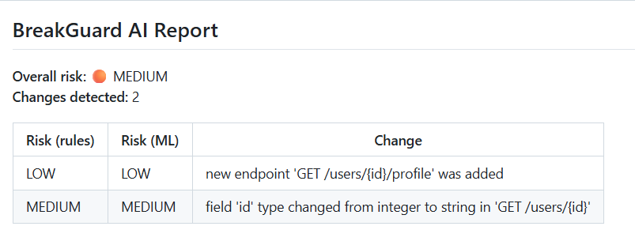

# BreakGuard AI

An open-source tool that detects breaking changes in API schemas (OpenAPI/JSON) between two versions, scores their risk, and reports them. It combines a rule-based engine with a machine learning classifier and runs automatically on pull requests through GitHub Actions.

## How it works

1. **Rule-based diffing**: parses two OpenAPI schema files and detects structural changes (removed endpoints, removed or retyped parameters, added endpoints).
2. **Risk scoring**: assigns HIGH, MEDIUM, or LOW risk to each change type based on real-world impact.
3. **ML classification**: a Logistic Regression model (TF-IDF features) predicts risk from the text description of each change, shown next to the rule-based score for comparison.

## Demo

BreakGuard comments on pull requests that change the API schema:

## Demo



See it live: [example pull request](https://github.com/omkarshinde7613/BreakGuard-AI/pull/1)

## Use it in your repo

1. Copy `breakguard/`, `requirements.txt`, and `.github/workflows/breakguard.yml` into your project.
2. Put your OpenAPI file at the repo root as `openapi.json` (or change the path in the workflow).
3. Open a pull request that changes it. BreakGuard posts a risk report automatically.

## Run locally

```bash
python -m venv venv
venv\Scripts\activate        # Mac/Linux: source venv/bin/activate
pip install -r requirements.txt
python -m breakguard.main schemas/old.json schemas/new2.json
```

Prints a terminal report and saves `report.json` and `report.md`.

To retrain the model:

```bash
python breakguard/generate_dataset.py
python breakguard/train_model.py
```

## Limitations and future work

- Training data is synthetic (template-generated), not taken from real API changelogs. Training on real-world changes is the next planned improvement.
- The ML model classifies text derived from the rule engine's own output rather than the raw diff, so the two layers are not fully independent. A future version will train directly on raw diff text.
- Only JSON OpenAPI files are supported. YAML support is planned.